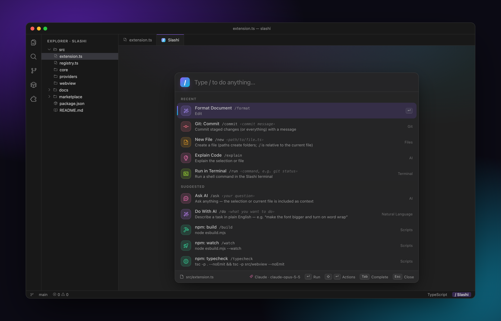
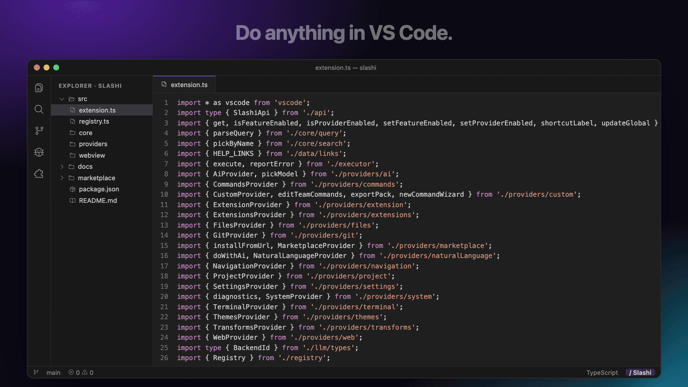
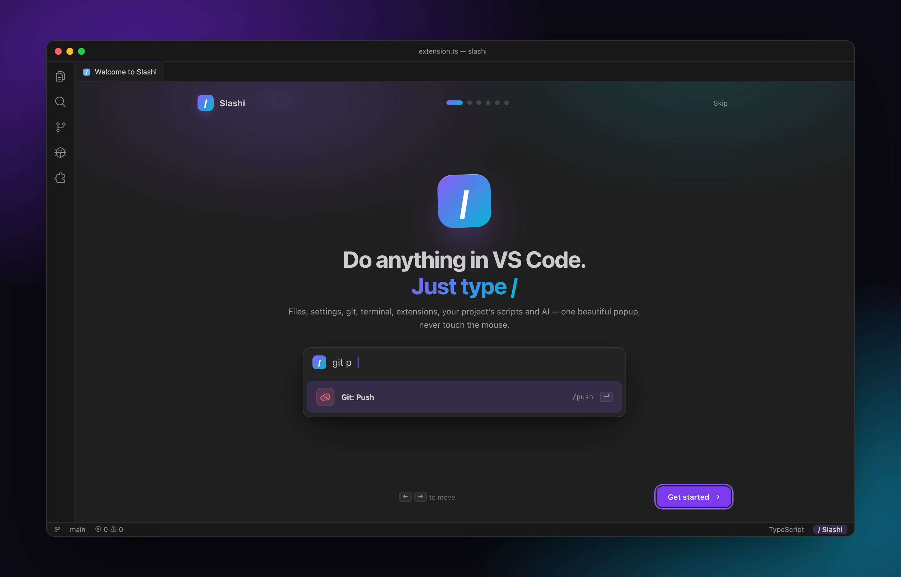
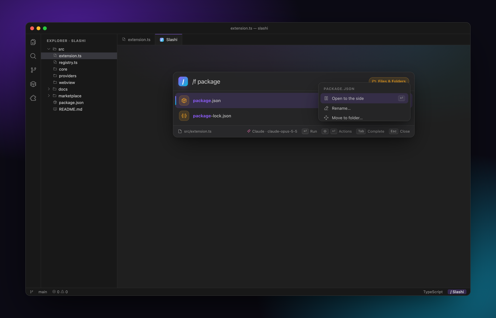
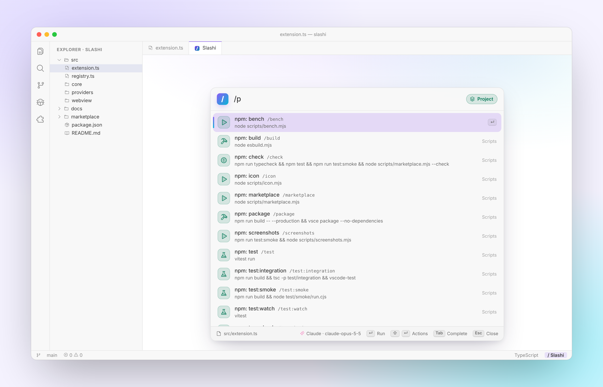
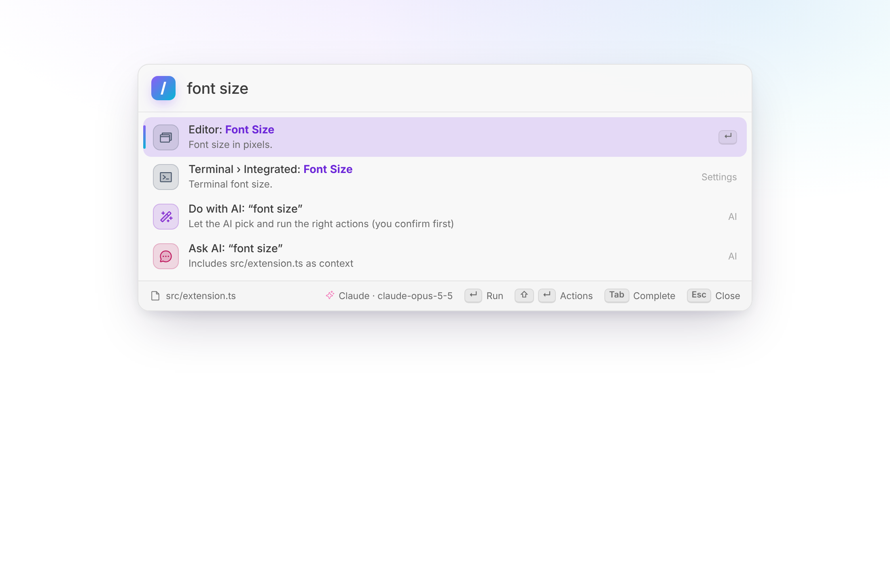
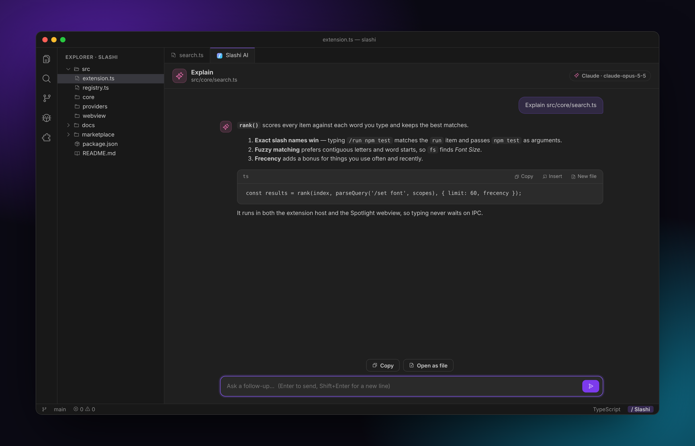
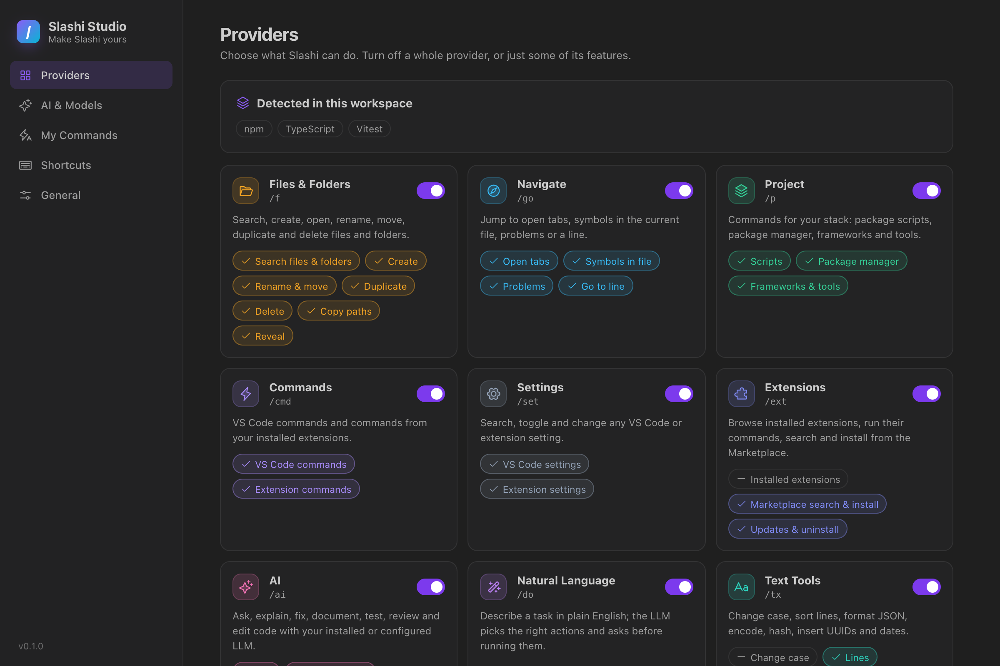

<div align="center">


# Slashi

### Do anything in VS Code. Just type `/`

One keyboard-first popup for your files, settings, extensions, Git, terminal, project scripts and AI, plus the commands you build yourself.

[](https://marketplace.visualstudio.com/items?itemName=meness.slashi)
[](https://marketplace.visualstudio.com/items?itemName=meness.slashi)
[](https://open-vsx.org/extension/meness/slashi)
[](https://open-vsx.org/extension/meness/slashi)

[](https://github.com/meness/slashi/actions/workflows/ci.yml)
[](vitest.config.mts)
[](LICENSE)
[](https://code.visualstudio.com/)

<picture>
  <source media="(prefers-color-scheme: light)" srcset="media/screenshots/hero-light.png">
  
</picture>



</div>

---

## Install

| Where | How |
|---|---|
| **VS Code Marketplace** | [Install from the Marketplace](https://marketplace.visualstudio.com/items?itemName=meness.slashi), or search **Slashi** in the Extensions view |
| **Open VSX** (VSCodium and other editors that use Open VSX) | [Install from Open VSX](https://open-vsx.org/extension/meness/slashi) |
| **Command line** | `code --install-extension meness.slashi` |
| **VSIX file** | Download `slashi-<version>.vsix` from the [latest release](https://github.com/meness/slashi/releases/latest), then **Extensions** → `…` → **Install from VSIX…** |

Slashi needs VS Code 1.93 or newer. On first launch, a short onboarding sets up the shortcut, your providers and AI.

<p align="center">
  
</p>

## What you get

Press `Cmd /` on macOS or `Ctrl /` on Windows and Linux, then type.

- **One list for everything.** About 180 VS Code commands with slash names, every extension command and setting, your files, open tabs, symbols, problems, Git branches and themes.
- **Commands for your project.** Slashi reads your manifests and offers `/test`, `/dev`, `/prisma-migrate` or `/compose-up` for npm, pnpm, yarn, bun, Next.js, Vite, Vitest, Jest, ESLint, Prettier, Prisma, Playwright, Docker, Make, Python, Rust, Go, .NET, Java, Terraform and more.
- **Files from the keyboard.** `/new`, `/mkdir`, `/rename`, `/move`, `/dup`, `/delete` (to the trash), copy paths, reveal.
- **AI where you work.** `/ask`, `/explain`, `/fix`, `/edit`, `/tests`, `/review` and `/commit-msg`, with GitHub Copilot, Claude Code, Codex, Claude, OpenAI, Ollama or any OpenAI-compatible server. Slashi works fine without AI too.
- **Plain English.** `/do make the font bigger and turn on word wrap` becomes a plan of real actions, which you see before it runs.
- **Your own commands.** Build them with a wizard, share them with your team in the repo, or install action packs from the marketplace.
- **Every theme.** Light, dark, high contrast and custom themes, with [Phosphor](https://phosphoricons.com) icons.

## 30-second tour

| Do this | Keys |
|---|---|
| Open Slashi | `Cmd /` (macOS) · `Ctrl /` (Windows/Linux) |
| Move | `↑` `↓` (or `Ctrl N` / `Ctrl P`) |
| Run | `Enter` |
| Complete a command, then type its arguments | `Tab`, e.g. `/run` → `Tab` → `npm test` |
| Run the last command again, with the same arguments | `/again` |
| Actions menu (rename, delete, copy path, hide, bind a key…) | `Shift Enter` or `→` |
| First action (e.g. open a file to the side) | `Alt Enter` |
| Hand what you typed to AI | `Cmd Enter` / `Ctrl Enter` |
| Clear, then close | `Esc` |
| Do with AI from anywhere | `Ctrl Cmd /` (macOS) · `Ctrl Shift Alt /` |

Type `/` plus a **scope** and a space to search one area only:

`/f` files · `/p` project · `/npm` scripts · `/set` settings · `/ext` extensions · `/git` · `/term` · `/ai` · `/do` · `/tx` text · `/tab` open tabs · `/@` symbols · `/err` problems · `/theme` · `/web` · `/my` your commands · `/market`

In Markdown, plain text and the Git commit box, typing `/` at the start of a line suggests slash commands inline.

<table>
<tr>
<td></td>
<td></td>
</tr>
<tr>
<td align="center"><sub>Files and folders, with <code>Shift Enter</code> for actions</sub></td>
<td align="center"><sub>Your project’s scripts and tools, detected automatically</sub></td>
</tr>
<tr>
<td></td>
<td></td>
</tr>
<tr>
<td align="center"><sub>Toggle or edit any setting in place</sub></td>
<td align="center"><sub>Streaming AI answers with Apply, Insert and Copy</sub></td>
</tr>
</table>

## Providers

Everything in the list comes from a **provider**. You can turn off a whole provider, or single **features** inside one: for example, keep Marketplace search but hide installed extensions. Use the **Studio** (`/studio`), the picker (`/providers`) or settings.

| Provider | Scope | Features (each can be turned off) |
|---|---|---|
| **Files & Folders** | `/f` | search · create (`/new`, `/mkdir`) · rename & move · duplicate · delete (to trash) · copy paths · reveal |
| **Navigate** | `/go` `/tab` `/@` `/err` | open tabs · symbols in file · problems · go to line (`/line 42:7`) |
| **Project** | `/p` `/npm` | scripts (package.json, Makefile, justfile, deno, composer; package.json scripts take extra arguments, e.g. `/test --watch`) · package manager · frameworks & tools (JS, Python, Go, Rust, .NET, Java, PHP, Ruby, Elixir, Flutter/Dart with FVM and Melos, Firebase, Supabase, Docker…) |
| **Commands** | `/cmd` | about 180 VS Code commands with slash names · every extension command |
| **Settings** | `/set` | every VS Code setting · every extension setting. Booleans toggle, enums pick, numbers and strings edit; set any value for the workspace or the current language |
| **Extensions** | `/ext` | installed extensions · Marketplace search & install · updates & uninstall |
| **AI** | `/ai` | ask/explain/summarize · fix/edit/doc/tests/review/convert · review your Git changes · commit messages · regex & shell generators · models |
| **Natural language** | `/do` | a sentence becomes a checked plan of actions |
| **Text tools** | `/tx` | case conversion · lines · encode & hash · JSON · inserts (UUID, dates, lorem) · stats |
| **Terminal & Tasks** | `/term` | `/run <cmd>` · VS Code tasks · debug configurations from launch.json · terminal management |
| **Git** | `/git` | commit/push/pull/sync/stage/undo/diff… · branch switching · stash |
| **Themes** | `/theme` | color themes · icon themes · light/dark toggle |
| **Web** | `/web` | Google, Stack Overflow, GitHub, MDN, npm, PyPI, crates.io, DevDocs, Can I Use, YouTube, plus your own engines |
| **My Commands** | `/my` | your commands · team commands · installed packs · commands from other extensions |
| **Marketplace** | `/market` | browse registries · install from URL or file |

Other extensions can add providers of their own (for example `/jira`). They show up in Studio with the extension's name and turn off the same way.

<p align="center"></p>

## AI

With `slashi.ai.provider` set to `auto` (the default), Slashi uses the first of these it finds:

1. **VS Code language models**: GitHub Copilot, or any extension that provides chat models. Nothing to set up.
2. **Claude**: `/ai-key` → Anthropic. Uses the official SDK; the default model is `claude-opus-5-5`, and `slashi.ai.anthropicEffort` sets the effort level.
3. **OpenAI**: `/ai-key` → OpenAI.
4. **Claude Code or Codex CLI**: no key needed. Slashi reuses your sign-in from the Claude Code extension (or `claude` on your PATH) or the `codex` CLI.
5. **Ollama**: local and free, found at `http://localhost:11434`.
6. **Any OpenAI-compatible server** (LM Studio, Groq, OpenRouter, Together, vLLM): set `slashi.ai.provider` to `openaiCompatible` and set `slashi.ai.baseUrl`.

Switch models with `/models`, and test the connection in **Studio → AI & Models**. Standing instructions go in `slashi.ai.customInstructions`.

| Command | What it does |
|---|---|
| `/ask <question>` | Answers with your selection (or the current file) as context |
| `/explain`, `/summarize`, `/review` | Explains, summarizes or reviews the selection or file |
| `/fix [hint]`, `/edit <instruction>`, `/doc` | Rewrites code. **Apply** (`Cmd/Ctrl Enter`) replaces the original, and `Cmd/Ctrl Z` undoes it. Code too large to send in full must be selected in parts, so Apply never cuts a file short |
| `/tests`, `/convert <target>`, `/name` | Writes tests, translates code, suggests names |
| `/review-changes` | Reviews your staged (or unstaged) Git changes before you commit |
| `/commit-msg` | Writes a Conventional Commits message from staged (or unstaged) changes into the Source Control box |
| `/regex <description>` | Writes a regex and inserts it |
| `/shell <description>` | Writes a shell command, which you review before it runs |
| `/do <task>` | Sends your request and a shortlist of matching actions to the model, drops any step that names an unknown action or setting, then shows the plan and runs it when you confirm |

## Make it yours

### 1. The wizard

`/new-command` asks for a name and steps, then saves the command to your settings or to the team file. No JSON needed.

### 2. Settings or a team file

Add commands to `slashi.customCommands` (user settings), or to **`.vscode/slashi.json`** to share them with everyone on the repo. The bundled [JSON schema](schemas/slashi.schema.json) gives you autocomplete and validation.

```jsonc
// .vscode/slashi.json
{
  "$schema": "https://raw.githubusercontent.com/meness/slashi/main/schemas/slashi.schema.json",
  "commands": [
    {
      "name": "ship",
      "title": "Ship It",
      "icon": "rocket-launch",
      "args": "commit message",
      "steps": [
        { "command": "workbench.action.files.saveAll" },
        { "slash": "/test" },
        { "terminal": "git add -A && git commit -m ${q:args} && git push" },
        { "notify": "Shipped 🚀" }
      ]
    }
  ]
}
```

| Step | Example |
|---|---|
| `command` | `{ "command": "editor.action.formatDocument" }` (optional `args`) |
| `slash` | `{ "slash": "/run npm test" }` |
| `terminal` | `{ "terminal": "npm run build", "cwd": "packages/web" }`. Later steps wait for it, and a failed or interrupted run stops the command (needs [shell integration](https://code.visualstudio.com/docs/terminal/shell-integration)). Add `"background": true` for servers and watchers. |
| `setting` | `{ "setting": "editor.fontSize", "value": 18, "target": "user" }` |
| `insert` | `{ "insert": "// TODO(${env:USER}): " }` |
| `open` | `{ "open": "https://github.com/${input:repo}" }` or a workspace path |
| `ai` | `{ "ai": "Translate to German: ${selection}", "output": "replace" }` (`panel` · `replace` · `insert`) |
| `notify` | `{ "notify": "Done" }` |
| `input` / `pick` | `{ "input": "Ticket?", "var": "ticket" }` → `${input:ticket}`; `{ "pick": ["patch","minor"], "var": "bump" }` |
| `wait` | `{ "wait": 500 }` |

**Variables:** `${args}`, `${selection}`, `${file}`, `${fileBasename}`, `${fileBasenameNoExtension}`, `${fileDirname}`, `${fileExtname}`, `${relativeFile}`, `${workspaceFolder}`, `${lineNumber}`, `${language}`, `${date}`, `${time}`, `${datetime}`, `${uuid}`, `${clipboard}`, `${env:NAME}`, `${config:setting.key}`, `${input:var}`. Add a default with `${args:3000}`. Prefix with `q:` for shell-safe quoting, e.g. `${q:selection}`.

> **Team files and packs ask first.** When a team or pack command would run terminal, VS Code or slash commands, change settings or open links, Slashi shows those steps and asks. **Always Allow** skips the question until the steps change. In them, `${env:NAME}`, `${config:…}` and `${clipboard}` expand only in `insert` and `notify` steps, so secrets stay in the editor. In [untrusted workspaces](https://code.visualstudio.com/docs/editor/workspace-trust), workspace-defined commands are ignored.

### 3. The action marketplace

`/market` lists **action packs**: Git Power Moves, AI Writing Tools, Focus & Present, Web Dev Toolkit, Handy Inserts and more. Packs built by Slashi carry a verified seal, and every download is checked against its registry listing before it installs. Before you install a pack, Slashi shows every step in it and marks the ones that can run commands. `/export-pack` turns your commands into a pack.

## Keyboard shortcuts

| Action | macOS | Windows / Linux |
|---|---|---|
| Open Slashi | `Cmd /` | `Ctrl /` |
| Do with AI | `Ctrl Cmd /` | `Ctrl Shift Alt /` |
| Toggle line comment (moved by Slashi) | `Cmd Alt /` | `Ctrl Alt /` |

To keep VS Code’s default comment shortcut, turn off `slashi.shortcut.useSlashKey`. Slashi then opens with `Cmd Shift ;` (macOS) or `Ctrl Shift /`. You can rebind everything in **Keyboard Shortcuts** (`/shortcuts`), separately per OS, and give any slash command its own key:

```jsonc
// keybindings.json
{ "key": "cmd+alt+u", "command": "slashi.run",  "args": "/upper" },
{ "key": "cmd+alt+g", "command": "slashi.open", "args": "/git " },
{ "key": "cmd+alt+t", "command": "slashi.run",  "args": "/run npm test" }
```

Scoped entry points such as `slashi.openFiles`, `slashi.openGit`, `slashi.openProject`, `slashi.openAI` and `slashi.doWithAI` can be bound too. Every result’s actions menu also has **Assign a keyboard shortcut…**.

## Settings

| Setting | Default | |
|---|---|---|
| `slashi.popup.style` | `spotlight` | `spotlight` (custom design) or `native` (VS Code Quick Pick, follows every accessibility setting) |
| `slashi.shortcut.useSlashKey` | `true` | `Cmd/Ctrl /` opens Slashi; the comment toggle moves to `Cmd/Ctrl Alt /` |
| `slashi.providers.*` | `true` | Turn each provider on or off |
| `slashi.disabledProviders` | `[]` | Providers from other extensions that are turned off |
| `slashi.disabledFeatures` | `[]` | Turn off single features, e.g. `extensions.installed` |
| `slashi.hiddenCommands` | `[]` | Hide single results (supports a trailing `*`) |
| `slashi.inlineTrigger.languages` | markdown, plaintext, scminput | Where `/` at line start suggests commands (`*` = everywhere) |
| `slashi.ai.provider` / `model` / `baseUrl` | `auto` | AI backend |
| `slashi.ai.confirmBeforeRun` | `true` | Confirm Do-with-AI plans. Steps that can reach a shell always ask |
| `slashi.ai.customInstructions` | `""` | Extra instructions for every AI request |
| `slashi.customCommands` | `[]` | Your commands |
| `slashi.marketplace.registries` | this repo | Registry index URLs (HTTPS) |
| `slashi.files.maxIndexed` | `20000` | File index size |

The AI backend, model, URL, effort, custom instructions, plan confirmation, web search engines and registry settings are machine-scoped: only your user settings can change them, never a repository’s workspace settings. Search **@ext:meness.slashi** in Settings for the rest.

## Privacy & security

- **No telemetry.** Slashi collects nothing.
- **API keys** live only in VS Code Secret Storage. A repository can’t change your AI backend, its URL, your instructions or your confirmation setting, so it can’t send your key or code to another server.
- **AI requests** go only to the backend you chose. Do-with-AI plans can use only real commands and settings. With `slashi.ai.confirmBeforeRun` off, a plan still asks before any step that can reach a shell: terminal commands, project scripts, custom commands, and settings that change what runs or what is trusted (Slashi, terminal, task, tool path, workspace trust, proxy and agent auto-approve settings).
- **Action packs** are fetched only over HTTPS, previewed step by step before installing, and checked against their registry listing. Only packs built by Slashi carry the verified seal.
- **Webviews** use a strict nonce-based Content Security Policy and load only bundled files. Raw HTML in model output is escaped, never rendered.
- **Untrusted workspaces:** workspace-defined commands are ignored. Team commands (in `.vscode/slashi.json` or the workspace's `slashi.customCommands`) and packs ask before running anything that can reach a shell.

See [SECURITY.md](SECURITY.md) to report a vulnerability.

## Performance

The popup ranks local results itself, so typing doesn't wait on the extension host. Only big catalogues, such as workspace files, are ranked in the host. The index is lowercased up front, a subsequence check skips non-matches early, and highlights are computed only for visible rows. esbuild bundles the extension, and the Anthropic SDK loads only when you first use Claude.

`npm run bench` on an Apple M2 Pro:

| Items | Average rank | p95 |
|---:|---:|---:|
| 1,000 | 0.3 ms | 0.5 ms |
| 5,000 | 1.0 ms | 1.9 ms |
| 20,000 | 4.2 ms | 7.7 ms |

## Extend Slashi

For extension authors, teams and pack publishers. The full guide is [docs/BUILDING_ACTIONS.md](docs/BUILDING_ACTIONS.md).

- **Publish a pack:** add it to [`marketplace/packs`](marketplace/packs) in a pull request, or host a private registry for your team and add it to `slashi.marketplace.registries`.
- **Add commands from your extension** with `registerCommand`:

```ts
const slashi = await vscode.extensions.getExtension('meness.slashi')?.activate();
slashi?.registerCommand({
  extensionId: 'acme.deploy',
  name: 'deploy',
  title: 'Deploy to Staging',
  icon: 'rocket-launch',
  args: 'service',
  run: (service) => deploy(service),
});
```

- **Add a whole provider** with `registerProvider` (Slashi 0.5.0+): your own results under your own scope, such as `/jira ` listing your tickets. See [Providers](docs/BUILDING_ACTIONS.md#providers).

## Contributing

Bug reports, ideas, action packs and pull requests are welcome. You need **Node 20+** and **VS Code 1.93+**:

```bash
git clone https://github.com/meness/slashi && cd slashi
npm ci
npm run check       # what CI runs: typecheck, lint, format, unit and smoke tests, pack validation
```

Press **F5** (*Run Slashi*) to start an Extension Development Host with your build. [CONTRIBUTING.md](CONTRIBUTING.md) has the project layout, every script, the testing guide and how releases work.

## Support Slashi

Slashi is free and open source. If it saves you time, you can support its development with a crypto donation (ETH, Polygon, BTC or SOL). The addresses are in [DONATE.md](DONATE.md). Stars, reviews and bug reports help a lot too.

Inside VS Code, **Studio → Help & Support** (`/help-center`) collects the docs, troubleshooting, feedback links and `/support`. When you report a bug, run `/diagnostics` and paste the result. It copies versions and setup only, never keys, file names or code.

## License

[MIT](LICENSE) © meness and Slashi contributors. Icons by [Phosphor Icons](https://phosphoricons.com) (MIT). See [THIRD_PARTY_NOTICES.md](THIRD_PARTY_NOTICES.md).
